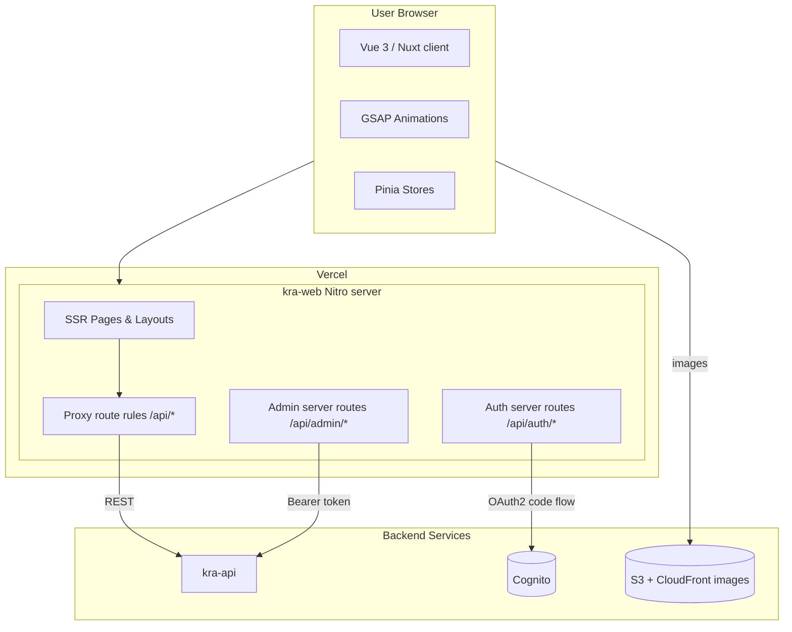

# kra-web

Frontend for the **KRA** portfolio at [krealalejo.dev](https://www.krealalejo.dev): a server-rendered, animated interface built with **Nuxt 4**. It shows projects (fetched from GitHub through `kra-api`), blog posts, a CV and a contact form, and includes a secured **admin area** for managing content and monitoring code quality.

**Stack:** Nuxt **4.6**, Vue **3.5**, Tailwind CSS **3**, Pinia **4**, GSAP **3**, VeeValidate **4** + Zod **4**, Vitest **5**, pnpm **11**, deployed on **Vercel**.

---

## Prerequisites

- **Node.js 24** (24.11 or newer, required by Nuxt 4.6)
- **pnpm 11**, enabled with `corepack enable` (the exact version is pinned in `package.json` → `packageManager`)
- **Environment variables**, see [Configuration](#configuration). A **`.env`** file at the root is required for local development.

---

## Quick Start

1. Copy `.env.example` to `.env` and set the required variables (API base URL, Cognito details).
2. Install dependencies: `pnpm install`
3. Run the development server: `pnpm dev`
4. Open the app at `http://localhost:3000`

---

## Commands

| Action | Command |
|--------|---------|
| Install dependencies | `pnpm install` |
| Run dev server (port **3000**) | `pnpm dev` |
| Build for production | `pnpm build` |
| Run the production build locally | `pnpm preview` |
| Generate static site (SSG) | `pnpm generate` |
| Unit tests (Vitest) | `pnpm test` |
| Unit tests (watch mode) | `pnpm test:watch` |
| Unit tests with coverage (80% threshold) | `pnpm test:coverage` |
| Run a single test file | `pnpm vitest run app/composables/useMarkdown.test.ts` |
| SonarCloud analysis | `pnpm sonar` |

---

## Pages

Base URL: `http://localhost:3000`

| Path | Description | Access |
|------|-------------|--------|
| `/` | **Home**: landing page with featured content, GitHub activity and animations | Public |
| `/projects` | **Projects**: list of portfolio projects | Public |
| `/projects/{owner}/{repo}` | **Project detail**: extended info fetched from GitHub | Public |
| `/blog` | **Blog**: article listing | Public |
| `/blog/{slug}` | **Post detail**: full blog post with Markdown and Mermaid diagrams | Public |
| `/contact` | **Contact**: contact form | Public |
| `/cv` | **CV**: experience, education and skills | Public |
| `/sitemap.xml` | **Sitemap**: generated by `@nuxtjs/sitemap`, including blog posts | Public |
| `/admin/login` | **Login**: admin authentication through the Cognito Hosted UI | Public |
| `/admin` | Redirects to `/admin/quality` when signed in, otherwise to `/admin/login` | Auth |
| `/admin/quality` | **Code quality**: SonarCloud and CloudWatch dashboards, cache management | Auth |
| `/admin/posts` | **Blog posts**: create, edit and delete posts | Auth |
| `/admin/projects` | **Projects**: edit project details | Auth |
| `/admin/cv` | **CV**: manage experience, education and skill categories | Auth |
| `/admin/activity` | **Activity**: manage the activity cards | Auth |
| `/admin/profile` | **Profile**: edit profile configuration and portrait | Auth |

---

## Architecture



> Full system architecture (C4 Level 1, 2 & 3): [kra-docs-architecture](https://github.com/krealalejo/kra-docs-architecture)

**Structure:** in production every browser call goes to `/api/*` on the Nitro server, which proxies it to `kra-api` (the browser never sees the backend URL); in development the app calls `kra-api` directly. Public pages are server-rendered and fetch data with `useAsyncData`/`useFetch`. The admin area (`/admin/**`) is a client-side SPA protected by the `auth` middleware: the Cognito code is exchanged for tokens in a server route, so the client secret never leaves the server, and admin server routes forward the session cookie to `kra-api` as a `Bearer` token. Pinia stores hold admin state, and GSAP drives the animations.

### Source layout

```
kra-web-frontend-nuxt/
├── .env.example
├── .github/
│   ├── dependabot.yml        # Monthly dependency updates
│   └── workflows/            # CI (tests, SSR smoke test, SonarCloud) and Dependabot alerts
├── nuxt.config.ts            # Modules, route rules, Nitro proxy rules, runtime config
├── vitest.config.ts          # Vitest with the Nuxt environment and coverage thresholds
├── tailwind.config.ts
├── package.json
├── pnpm-lock.yaml
├── pnpm-workspace.yaml       # pnpm overrides and allowed build scripts
├── public/                   # Static assets (icons, manifest, robots.txt)
├── app/
│   ├── app.vue               # Main entry point
│   ├── assets/               # Design system CSS
│   ├── components/           # Reusable UI components (admin/ for the admin area)
│   ├── composables/          # Shared logic: Markdown, Mermaid, GSAP, theme, forms, toasts
│   ├── layouts/              # Page layouts (default, admin)
│   ├── middleware/           # Auth guard for /admin
│   ├── pages/                # File-based routing
│   ├── stores/               # Pinia stores (blog, activity)
│   ├── tests/                # Vitest setup
│   └── types/                # TypeScript definitions
└── server/
    ├── api/
    │   ├── admin/            # Authenticated routes proxied to kra-api
    │   ├── auth/             # Cognito login, callback, session and logout
    │   └── _sitemap/         # Blog post source for the sitemap
    └── plugins/              # Nitro plugins (non-blocking CSS)
```

---

## Configuration

Variables used in Vercel and in the local `.env` (see `.env.example`):

| Variable | Purpose |
|----------|---------|
| `NUXT_PUBLIC_API_BASE_URL` | Base URL of the **kra-api** backend. It is read **at build time** to generate the Nitro proxy rules, so it must be set when running `pnpm build` |
| `NUXT_COGNITO_CLIENT_ID` | AWS Cognito App Client ID |
| `NUXT_COGNITO_CLIENT_SECRET` | AWS Cognito App Client Secret (server only) |
| `NUXT_PUBLIC_COGNITO_DOMAIN` | Cognito Hosted UI domain |
| `NUXT_COGNITO_REDIRECT_URI` | Redirect URI after login (**.../api/auth/callback**), must match the Cognito allowed callback URLs |
| `NUXT_COGNITO_LOGOUT_URI` | Redirect URI after logout, must match the Cognito allowed sign-out URLs |

> **Note:** all routes under `/admin` use `ssr: false` so the Cognito auth flow runs on the client; `/admin/login` stays server-rendered.

---

## Deployment

Deployed on **Vercel**, which builds and deploys `main`. Environment variables are set in the Vercel project settings, and the project must use **Node.js 24**. The supporting AWS resources (Cognito user pool, S3 + CloudFront for images, and the IAM user Vercel uses to write logs to CloudWatch) are managed by **Terraform** in `kra-infra`.

On every push and pull request to `main`, **GitHub Actions** runs the unit tests with coverage, builds the app and smoke-tests the production server (the main public routes must return 200 with no request errors), and then runs the SonarCloud analysis. Dependabot opens grouped dependency updates monthly.

> After a dependency upgrade, redeploy on Vercel with **"Use existing Build Cache"** unchecked so the build does not reuse stale modules.
